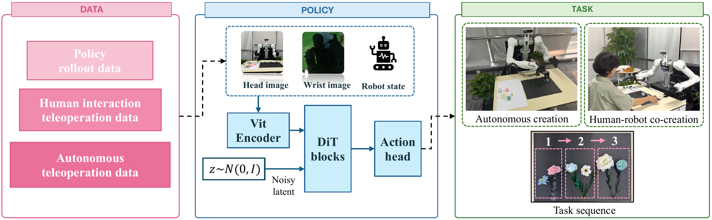

<h1 align="center">Co-Creation in Bloom: Artistic Co-Creation Manipulation with Deformable Flower Petals</h1>

<p align="center">
  <strong>Accepted at the 1st Embodied4Arts Workshop @ RSS 2026</strong>
</p>

<p align="center">
  Kefei Zhu*, Jinzhong Gu*, Yue Xin*, Guanqi He, Yi Qu, Yaodong Yang, Yuanpei Chen, Hao Dong<br>
  Peking University · Tsinghua University<br>
  <sup>* Equal contribution</sup>
</p>

<p align="center">
  <a href="https://petaldex.github.io/">Project Website</a> ·
  <a href="https://huggingface.co/datasets/jasonGUself/PetalDex">Dataset</a>
</p>

<p align="center">
  
</p>

**PetalDex** is a bimanual dexterous robot system for artistic human–robot co-creation with flower petals.

## Quick Start

This repository provides dataset converters, policy training, and offline action prediction for **Tianji Arms and Wuji Hands**. Pretrained PetalDex checkpoints and robot control drivers are not included. See the [usage guide](docs/USAGE.md) for environment requirements, checkpoint handling, and evaluation.

### 1. Install

Use Linux x86_64 with an NVIDIA GPU and a driver supporting CUDA 12.8. Install [uv](https://docs.astral.sh/uv/getting-started/installation/), then run:

```bash
git clone https://github.com/zhucoffee/PetalDex.git
cd PetalDex
uv sync --frozen
source .venv/bin/activate
export PROJECT_ROOT="$PWD"
```

Python 3.9.23 and PyTorch 2.8.0 are specified in `pyproject.toml`. Run the commands below from the project root with this environment activated. The lock file uses the Aliyun PyPI mirror and targets Linux x86_64.

### 2. Download and prepare data

Download the human–robot co-creation subset and convert it to Zarr:

```bash
hf download jasonGUself/PetalDex --repo-type dataset \
  --include 'hdf5/robot_human_co-creation/*' --local-dir data/PetalDex
python scripts/data/convert_hdf5_to_zarr.py \
  --input data/PetalDex/hdf5/robot_human_co-creation \
  --output data/flowers.zarr
```

Replace `robot_human_co-creation` with `robot_auto` in both paths to use the other subset.

The converter expects `episode_*.h5` files with 224 × 224 JPEG images. It creates a new destination and refuses to overwrite an existing dataset. See [data format](docs/DATA.md) for keys, dimensions, and conversion details.

### 3. Train

```bash
bash scripts/training/run_train_ddp.sh \
  "$PROJECT_ROOT/data/flowers.zarr" arrange_flowers 64 1000 0
```

Arguments: dataset path, experiment name, batch size per GPU, epochs and GPU IDs. For two GPUs, replace `0` with `0,1`.

Checkpoints and `normalizer.pkl` are saved under `data/outputs/`. Training settings are in `petal/config/petal_workspace.yaml`. W&B logging defaults to offline; the image encoder downloads pretrained weights on first use. The default configuration uses all episodes for training (`val_ratio: 0`); it does not produce held-out validation metrics.

### 4. Predict actions

Select the checkpoint and normalizer from your training run, then predict from an observation in the converted dataset:

```bash
python scripts/inference/policy.py \
  --ckpt /path/to/training_run/checkpoints/latest.ckpt \
  --normalizer /path/to/training_run/normalizer.pkl \
  --zarr data/flowers.zarr --episode 0 --frame 0 \
  --device cuda:0 --output predictions/actions.npy
```

Replace `/path/to/training_run` with your output directory under `data/outputs/`. Episode and frame indices start at zero.

Normalization is also embedded in the checkpoint, so `--normalizer` is optional. Weight selection defaults to the checkpoint's EMA setting; use `--weights model` or `--weights ema` to select explicitly.

With the supplied configuration, the script prints and saves **16 × 54 joint targets**, ordered as **left arm (7), right arm (7), left hand (20), right hand (20)**, in the same units as the dataset. It reads a recorded observation and saves an action chunk; live sensing and robot execution require a separate controller. Only load checkpoints and normalizer files from sources you trust: these files use Python pickle serialization.

## Use your own recordings

Configure the camera and joint topics in `configs/mcap_to_zarr.yaml`, then convert your ROS 2 bags:

```bash
export BAG_ROOT=/path/to/recordings
python scripts/data/convert_mcap_to_wuji_bimanual_zarr.py \
  --config configs/mcap_to_zarr.yaml --output data/custom.zarr
```

`BAG_ROOT` contains the `rosbag_*` recording folders. Use the resulting Zarr path in the training command above.

## Repository layout

| Path | Purpose |
|---|---|
| `petal/` | Models, datasets and training configuration |
| `configs/` | ROS recording conversion settings |
| `scripts/data/` | Data conversion and preparation |
| `scripts/training/` | Single-GPU and multi-GPU training |
| `scripts/inference/` | Model loading and action prediction |
| `train.py` | Training entry point |
| `pyproject.toml`, `uv.lock` | Python environment and dependencies |
| `accelerate_config.yaml` | Training launch settings |

## Contribute

Questions, bug reports, and pull requests are welcome. See [CONTRIBUTING.md](CONTRIBUTING.md) for the information that helps reproduce a problem. Please include your environment, command, and relevant log excerpt.

## Citation

If you use PetalDex in research, please cite:

```bibtex
@inproceedings{zhu2026petaldex,
  title = {Co-Creation in Bloom: Artistic Co-Creation Manipulation with Deformable Flower Petals},
  author = {Zhu, Kefei and Gu, Jinzhong and Xin, Yue and He, Guanqi and Qu, Yi and Yang, Yaodong and Chen, Yuanpei and Dong, Hao},
  booktitle = {RSS 2026 Workshop Embodied4Arts},
  year = {2026},
  url = {https://petaldex.github.io/}
}
```

Machine-readable citation metadata is in [CITATION.cff](CITATION.cff).

## Acknowledgements and license

We thank [Diffusion Policy](https://github.com/real-stanford/diffusion_policy) for the adapted utilities. PetalDex code is available under the [MIT License](LICENSE). See [third-party notices](THIRD_PARTY_NOTICES.md) for upstream acknowledgements and licenses, and the [dataset card](https://huggingface.co/datasets/jasonGUself/PetalDex) for dataset licensing.
